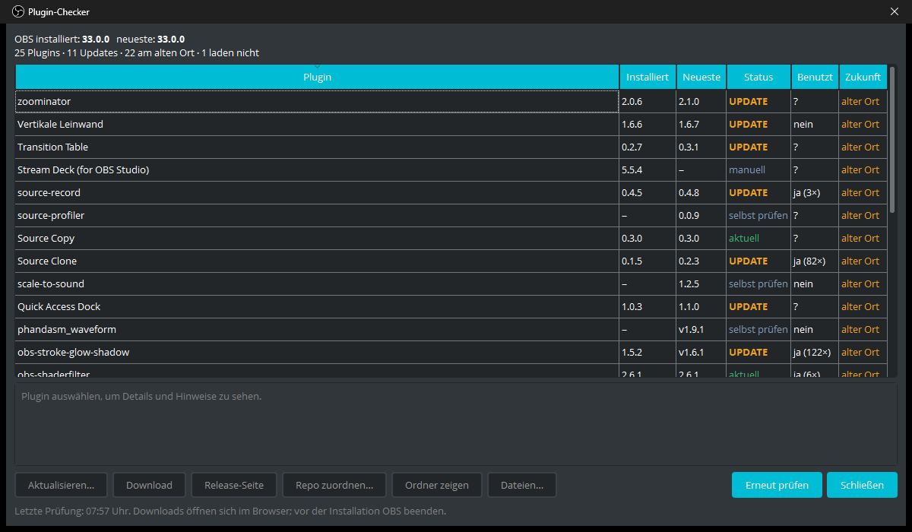

# Plugin-Checker für OBS Studio

[English](README.md) · Deutsch

Ein OBS-Plugin, das alle installierten Drittanbieter-Plugins auflistet und auf GitHub prüft, ob es neuere Versionen gibt. Gedacht vor allem für den Umstieg auf **OBS 33**: Dort hat sich das Laden von Plugins geändert, und Plugins an alten Orten laden nur noch übergangsweise (laut Ankündigung bis OBS 34; OBS selbst schreibt nur „in Zukunft“).

Du öffnest es in OBS über **Werkzeuge → Plugin-Checker**. Gibt es Updates, steht die Anzahl direkt im Menü, z. B. „Plugin-Checker (2 Updates)“.

Die Oberfläche folgt der OBS-Sprache und ist auf Englisch, Deutsch, Spanisch, Französisch, Italienisch, Portugiesisch, Polnisch, Niederländisch, Japanisch, Koreanisch und vereinfachtem Chinesisch verfügbar; bei anderen Sprachen erscheint sie auf Englisch.



## Was es prüft

| | |
|---|---|
| **Version** | Installierte Version aus dem OBS-33-`manifest.json`, der `Info.plist` (macOS) oder der Datei-Versionsressource (Windows) |
| **Neueste Version** | Das neueste GitHub-Release mit direktem Download für dein System (`.pkg` / `.exe` / `.deb`) |
| **Legacy** | Plugins in alten Orten/Ordnerstrukturen, die OBS 34 nicht mehr lädt (siehe unten) |
| **Doppelte Kopien** | z. B. eine neue `.plugin`-Version plus eine alte Kopie unter `/Library/…` |
| **Nicht geladen** | Plugins, die auf der Platte liegen, die OBS aber nicht geladen hat oder die im Plugin-Manager deaktiviert sind |
| **Gepflegt?** | Archivierte Repos und Releases, die älter sind als die aktuelle OBS-Hauptversion |
| **OBS selbst** | Installierte gegen neueste OBS-Version |
| **Genutzt?** | In welchen Szenensammlungen und Profilen die Quellen, Filter, Übergänge und Encoder des Plugins vorkommen. Plugins, deren Quellen nirgends benutzt werden, sind markiert |
| **Fehlende Bibliotheken** | Plugins, die DLLs brauchen, die es nicht mehr gibt (z. B. nach einem OBS-Update), und deshalb nicht laden |
| **Reste** | Datenordner ohne Plugin, z. B. von entfernten oder umbenannten Plugins |

Die Tabelle zeigt pro Plugin eine Zeile mit Version, Update-Status, ob es benutzt wird, und die Spalte **Zukunft**: *neuer Ort*, *alter Ort* (läuft noch, wird aber irgendwann nicht mehr geladen), *lädt nicht* (z. B. fehlende DLLs) oder *Reste*. Alle Hinweise zum ausgewählten Plugin stehen darunter.

**Downloads** passen zum System: Unter Windows wird ein Installer angeboten, bei einer **portablen OBS** dagegen bevorzugt das ZIP, weil Installer nur in die normale OBS installieren. Downloads für andere CPUs (ARM, 32 Bit) werden übergangen. Unter dem Plugin steht, welche Datei geladen wird.

**Aktualisieren…** (Windows) lädt das Release-ZIP von GitHub, prüft die Prüfsumme, die GitHub dafür angibt, und entpackt es in einen Arbeitsordner. Erkannt werden das alte flache Schema (`obs-plugins/64bit` + `data/obs-plugins/<Name>`), das ProgramData-Schema (`<Name>/bin/64bit` + `<Name>/data`) und das OBS-33-Schema (`<Name>/<Name>.dll` + `data`). Übernommen werden nur die DLLs des Plugins und sein data-Ordner, an den Ort, an dem das Plugin schon liegt. Vorher zeigt eine Vorschau jede Datei, die ersetzt wird oder neu dazukommt. ZIPs mit Pfaden außerhalb ihres Ordners, Zielpfade außerhalb der OBS-Ordner oder Dateien, die zu OBS oder anderen Plugins gehören, führen zum Abbruch. Getauscht wird erst nach dem Beenden von OBS; die alten Dateien und `restore.ps1` liegen in `plugin_config/obs-plugin-checker/updates`.

**Dateien…** zeigt alle Dateien eines Plugins: Plugin, Daten, mitgelieferte DLLs, Kopien neben `obs64.exe` und seinen Einstellungsordner. **Entfernen…** verschiebt sie nach dem Beenden von OBS in einen Backup-Ordner (`plugin_config/obs-plugin-checker/removed`), mit `restore.ps1`/`restore.sh` zum Zurückholen. Gelöscht wird nichts, DLLs, die andere Plugins brauchen, bleiben liegen.

## macOS: Plugin wird blockiert

Die macOS-Pakete sind nicht von Apple signiert und notarisiert (warum, steht unter [Unterstützen](#unterstützen)). Deshalb kann macOS sie beim ersten Öffnen blockieren, etwa mit der Meldung, dass Apple die Datei nicht auf Schadsoftware prüfen kann. So kommst du trotzdem ans Ziel:

1. **Installer (`.pkg`):** Doppelklicke die Datei einmal und schließe die Meldung mit **Fertig**. Öffne dann **Systemeinstellungen → Datenschutz & Sicherheit**, scrolle nach unten zum Hinweis, dass die Datei blockiert wurde, und klicke auf **Trotzdem öffnen**. Nach der Bestätigung mit deinem Passwort oder Touch ID läuft der Installer normal durch. (Bis macOS 14 reicht auch Rechtsklick auf die Datei → **Öffnen** → **Öffnen**.)
2. **ZIP (`.plugin`):** Entpacke es nach `~/Library/Application Support/obs-studio/plugins/`. Lädt OBS das Plugin danach nicht (es fehlt unter **Werkzeuge**), entferne im Terminal die Download-Markierung und starte OBS neu:
   ```sh
   xattr -dr com.apple.quarantine ~/Library/Application\ Support/obs-studio/plugins/obs-plugin-checker.plugin
   ```

Die Pakete werden ausschließlich von der GitHub-CI aus dem Code in diesem Repo gebaut. Die Prüfsummen stehen in `SHA256SUMS.txt` beim Release (`shasum -a 256 <Datei>` zum Vergleichen).

## Datenschutz und Sicherheit

- Szenensammlungen werden nur nach Quellentypen durchsucht; Namen, Einstellungen und URLs werden weder angezeigt noch gespeichert oder geloggt. Von den Profilen werden nur die Encoder-Einträge in `basic.ini` gelesen; `service.json` (Stream-Key), `global.ini` und `user.ini` öffnet das Plugin nie.
- Ins OBS-Log schreibt es nur seine Version und die Anzahl Plugins und Updates.
- Netzwerk: nur HTTPS-Anfragen an `api.github.com`, ohne Anmeldung und ohne Tokens. GitHub erfährt dabei, welche Plugin-Repos abgefragt werden.
- Links werden nur geöffnet, wenn es Web-Links sind; Downloads nur von `github.com`.
- Pfade im Fenster zeigen den Benutzerordner als `~`, damit der Windows-Benutzername im Stream nicht zu sehen ist.

Woher das Repo kommt, in dieser Reihenfolge:
1. die eigene Zuordnung über „Repo zuordnen…“
2. `urls.repository` aus dem `manifest.json` des Plugins (neu in OBS 33)
3. die mitgelieferte Liste [`data/known-plugins.json`](data/known-plugins.json)

## OBS 33: Was sich bei Plugin-Orten ändert

Quelle: [obsproject/obs-studio#13594](https://github.com/obsproject/obs-studio/pull/13594), [KB „Legacy Plugin Locations“](https://obsproject.com/kb/legacy-plugin-locations).

| System | Aktuell (OBS 33+) | Legacy (lädt nur bis OBS 34) |
|---|---|---|
| macOS | `~/Library/Application Support/obs-studio/plugins/<Name>.plugin` | `…/obs-studio/plugins/<Name>/bin/<Name>.so` (auch unter `/Library`) |
| Windows | `C:\ProgramData\obs-studio\plugins\<Name>\<Name>.dll` + `data\` | `…\plugins\<Name>\bin\64bit\<Name>.dll`, `C:\Program Files\obs-studio\obs-plugins\64bit\` |
| Linux | `~/.local/share/obs-studio/plugins/<Name>/<Name>.so`, `/usr/lib/obs-modules/plugins/` | `~/.config/obs-studio/plugins/<Name>/bin/64bit/`, `/usr/lib/obs-plugins/` |

Neue Orte haben Vorrang. Liegt ein Plugin doppelt vor, lädt OBS 33 die neue Kopie und blockiert die alte.

## Bauen (macOS)

Es reichen die Command Line Tools (`xcode-select --install`), Xcode und CMake sind nicht nötig. OBS muss unter `/Applications/OBS.app` installiert sein, oder du setzt `OBS_APP=/pfad/zu/OBS.app`.

```bash
./build-macos.sh install
```

Das Skript lädt einmalig die OBS-31.1.1-Quellen (nur für die Header) und die Qt-6.8.3-Header aus `obsproject/obs-deps`, jeweils mit Prüfsumme. Das sind dieselben Versionen, die auch [obs-plugintemplate](https://github.com/obsproject/obs-plugintemplate) nutzt. Danach baut es `build/obs-plugin-checker.plugin`, signiert es ad hoc und kopiert es nach `~/Library/Application Support/obs-studio/plugins/`. Danach OBS neu starten.

**Kompatibilität:** Das Plugin wird gegen die libobs-API 31.1 gebaut und lädt damit in OBS 31.1, 32.x und 33. Funktionen, die es erst in OBS 33 gibt (`obs_get_module_version`, `obs_is_legacy_module`), werden zur Laufzeit gesucht und nur genutzt, wenn vorhanden. Das Plugin enthält ein OBS-33-`manifest.json`.

Gebaut wird für die Architektur des installierten OBS.app (hier arm64). Für eine Universal-Version braucht es ein Universal-OBS zum Linken.

### Testen ohne OBS-Fenster

```bash
./build-macos.sh test
```

Das startet libobs aus OBS.app, lädt das Plugin über `obs_open_module` (gleiche Versions- und Export-Prüfung wie OBS), führt Scan und GitHub-Abfrage aus und speichert ein Bild des Dialogs nach `build/dialog.png`. Mit `./build-macos.sh test force` wird der Cache übergangen.

## Getestet

| | Ergebnis |
|---|---|
| OBS 32.1.0 (macOS arm64, Qt 6.8.3) | lädt, Start-Check läuft, keine Fehler im Log |
| OBS 33.0.0 (macOS arm64, Qt 6.11.1) | lädt, Start-Check läuft, Plugin-Manager zeigt Name/ID/Version aus `manifest.json` |
| OBS 32.1.0 (macOS arm64), CI-Build Universal | lädt ohne Gatekeeper-Warnung; Versionen, Neueste, Status, Download-Datei und Download stimmen; zweite Stream-Deck-Kopie unter `/Library/…` korrekt erkannt |
| OBS 32.0.2 (Ubuntu 24.04, Xvfb), CI-Build | Erkennung, Versionen und Legacy-Hinweis stimmen; nicht ladendes Plugin erkannt; Auswahl der `-legacy.deb` (GitHub-Antworten eingespielt); Entfernen und `restore.sh` |
| Headless (`./build-macos.sh test`) | erkennt Update (3.0.2 → 3.2.1), Legacy-Ordner, doppelte Kopien, Repo aus `manifest.json`, GitHub-Limit mit Cache-Fallback |

**Bekannter OBS-33-Fehler:** Hat ein Drittanbieter-Plugin ein `manifest.json`, meldet OBS 33.0.0 beim Beenden 6 zusätzliche „memory leaks“. Ohne Manifest sind es 0. Das passiert in OBS selbst und ist für den Betrieb harmlos.

## Hinweise

- **GitHub-Limit:** Ohne Anmeldung erlaubt GitHub 60 API-Anfragen pro Stunde. Antworten werden 6 Stunden zwischengespeichert, „Erneut prüfen“ fragt neu an. Das Plugin meldet sich bewusst nicht an und liest keine Tokens aus der Umgebung.
- **Netzwerk:** Das Plugin nutzt libcurl statt Qt Network, weil OBS auf macOS kein Qt-TLS-Backend mitliefert. Die Anfragen laufen in einem eigenen Thread.
- **Downloads:** Downloads öffnen sich im Browser. Vor der Installation OBS beenden.
- **Einstellungen:** Eigene Zuordnungen und Cache liegen im OBS-Ordner `plugin_config/obs-plugin-checker/`, also unter macOS in `~/Library/Application Support/obs-studio/`, unter Linux in `~/.config/obs-studio/` und unter Windows in `%APPDATA%\obs-studio\` (portable OBS: in ihrem eigenen `config`-Ordner).
- **Builds:** Die CI baut bei jedem Pull Request Windows x64 (ZIP), macOS Universal (`.plugin` als ZIP und `.pkg`) und Ubuntu 24.04 x86_64 (`.tar.xz`). „Aktualisieren…“ gibt es bisher nur unter Windows; auf macOS und Linux öffnet „Download“ den passenden Installer bzw. das Paket im Browser.

## Projektstruktur

```
src/plugin-main.cpp      Modul-Einstieg, Menüeintrag, Start-Check
src/plugin-scanner.cpp   Plugins finden: libobs-Module + Plugin-Ordner, Legacy-Erkennung, Versionen
src/update-checker.cpp   GitHub-Abfragen, Cache, Vergleich
src/http-worker.cpp      libcurl auf eigenem Thread
src/checker-dialog.cpp   Fenster
data/                    Locale (11 Sprachen), known-plugins.json, manifest.json
tools/harness.cpp        Headless-Test
tools/obs_plugin_checker.py  ursprüngliches Kommandozeilen-Skript
```

## Haftungsausschluss

Nutzung auf eigene Gefahr. Der Plugin-Checker verschiebt und ersetzt Plugin-Dateien; er legt zwar Backups und Wiederherstellungs-Skripte an, trotzdem solltest du vor Updates oder dem Entfernen von Plugins deinen OBS-Ordner sichern. Die Software wird ohne Gewährleistung bereitgestellt; soweit gesetzlich zulässig, haften die Autoren nicht für Schäden, siehe Abschnitte 15 und 16 der [GPL](LICENSE.md). Dieses Projekt steht in keiner Verbindung zum OBS Project oder zu den Plugin-Autoren und wird von ihnen nicht unterstützt.

## Unterstützen

Damit macOS die Pakete ohne Warnung öffnet, müssen sie mit einem Apple-Developer-Konto signiert und notarisiert werden. Das kostet 99 € im Jahr. Der Plugin-Checker ist kostenlos und ein Hobbyprojekt. Wenn er dir hilft und du meine Arbeit unterstützen möchtest, freue ich mich sehr darüber, und vielleicht reicht es irgendwann für signierte Pakete: [ko-fi.com/n3ckarmann](https://ko-fi.com/n3ckarmann)

## Lizenz

GNU General Public License v3.0, siehe [LICENSE.md](LICENSE.md).
